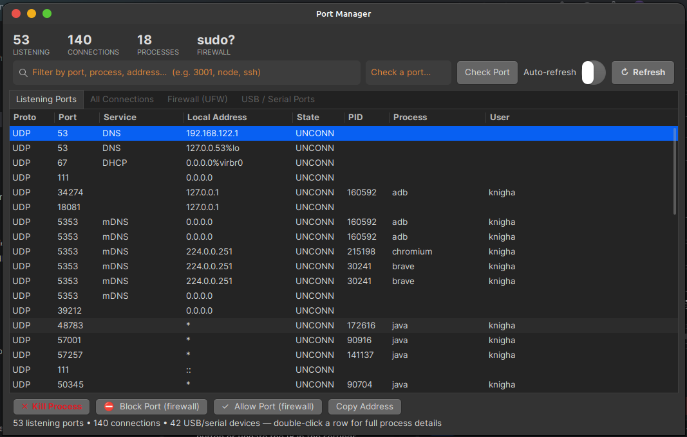

# PortMan — Port Manager for Linux


**Every port on your machine, in one clean window.** See what's listening, who owns it, what's connected where — then kill it, block it, or free it, without memorising `ss` flags or `ufw` syntax.



## Features

- **Listening Ports tab** — every open TCP/UDP port with protocol, service name (DNS, SSH, PostgreSQL, your dev server on 3001…), local address, PID, process name, and owning user
- **All Connections tab** — live connections (ESTABLISHED, TIME_WAIT, …) with the remote IP:port on the other end
- **Firewall tab** — UFW status and numbered rules; add allow/deny rules and delete rules from the GUI
- **USB / Serial tab** — `lsusb` devices plus `/dev/ttyUSB*`, `ttyACM*`, and serial ports
- **Kill Process** — free a port in one click (SIGTERM first, sudo fallback via `pkexec` for other users' processes)
- **Block / Allow Port** — firewall rules straight from the port list, with an extra confirmation before touching SSH (port 22)
- **Check Port** — type any port number: is it free, or who is holding it? Verified with a real bind test
- **Live filter** — search by port, process, address, service, or user
- **Auto-refresh** — optional 3-second live rescan
- **Process details** — double-click any row for the full command line of the owning process
- **Headless mode** — `python3 portman.py --cli` prints the listening-port table in a terminal

## Install

```bash
git clone https://github.com/sahilimamk/portman.git
cd portman
./install.sh          # installs to ~/.local/bin + adds an app-menu entry
portman               # or just: python3 portman.py
```

No build step, no pip installs. `install.sh` simply copies the single-file app to `~/.local/bin/portman` and registers a **Port Manager** entry in your application menu.

## Requirements

- Linux with GTK 3 (Linux Mint, Ubuntu, Fedora, Arch…)
- `python3` with PyGObject (`python3-gi`) — preinstalled on most GTK desktops
- `iproute2` (provides `ss`), `lsusb` — standard on most distros
- Optional: `ufw` for the firewall tab, `pkexec` (polkit) for privileged actions

## Safety

- PortMan **never asks for or stores your password** — privileged actions (firewall changes, killing another user's process) go through the system's graphical `pkexec` prompt
- Killing PID 1 / kernel threads is refused outright
- Blocking port 22 (SSH) asks for explicit confirmation, so you can't lock yourself out with one stray click

## How it works

One Python file, standard library + GTK only. Port data comes from `ss -tulnp` / `ss -tunap`, process owners are resolved through `/proc`, firewall state through `ufw status numbered`, and USB/serial devices through `lsusb` and `/dev`. All scans run off the UI thread so the window never freezes.

## Tests

```bash
python3 tests/test_parser.py
```

Covers the `ss` output parser (IPv4, IPv6, wildcard, and process-less sockets) and address/port splitting.

## Roadmap ideas

- Per-port traffic counters
- Saved "expected ports" profile with alerts when something new starts listening
- nftables-native firewall backend

## License

MIT — see [LICENSE](LICENSE).
